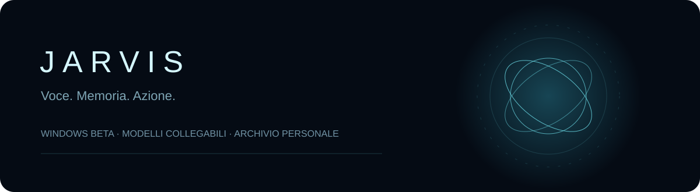
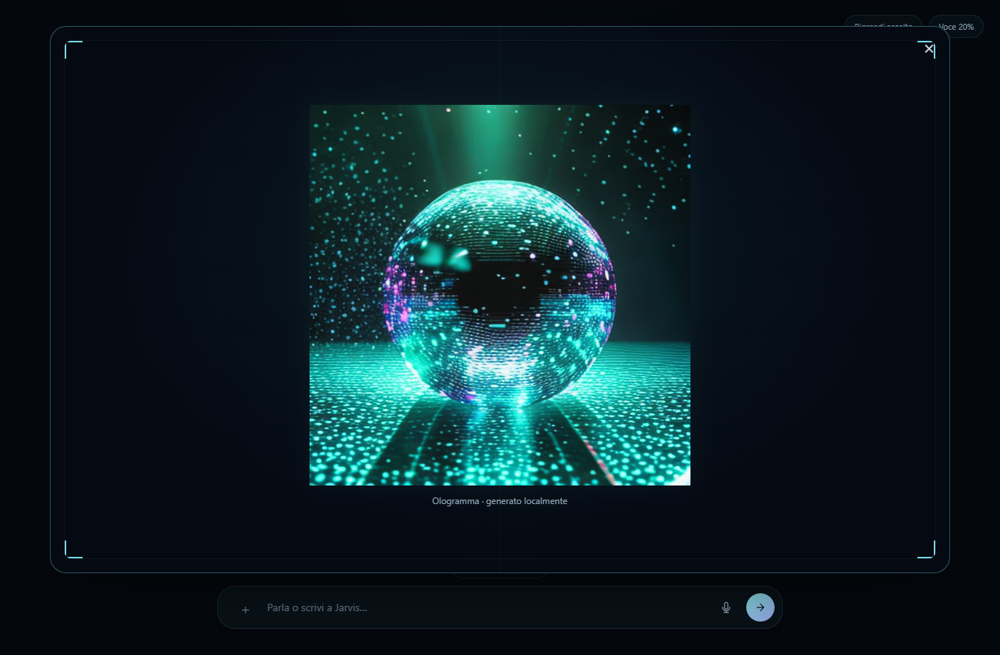
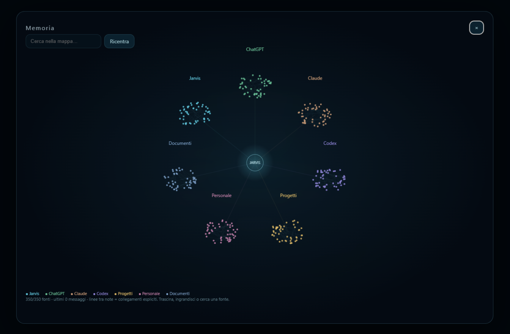

  

**Un nucleo animato, una conversazione continua, una memoria consultabile.**

[Scarica Jarvis](https://github.com/tommowx/jarvis/releases/latest) · [Novità](https://github.com/tommowx/jarvis/releases) · [Roadmap e macOS](ROADMAP.md)

## Novità della beta 0.10

| Funzione | Stato |
|---|---|
| ChatGPT con account collegato | Verificato sul PC di sviluppo |
| Claude API, OpenAI API, Ollama, API compatibili | Adattatori verificati con fixture; servono modello/accesso dell’utente |
| Memoria interna e importazioni locali | Testati persistenza, deduplicazione e fonti |
| Mappa animata a colori | Fonti reali e collegamenti espliciti, fino a 6.000 note visibili |
| Auto-modifiche | Richiedono sorgenti e dipendenze di sviluppo sul PC |
| macOS | [Anteprima sperimentale Intel e Apple Silicon](MACOS.md); limiti e permessi descritti nella guida |
| Linux | In roadmap |

*La schermata della mappa usa dati dimostrativi, senza conversazioni personali.*

### Collegamenti e riservatezza
Il modello scelto riceve la domanda e la memoria pertinente autorizzata. Le chiavi API sono cifrate tramite Windows e non esportate. Le API possono essere a pagamento; nessuna nuova API viene attivata senza configurazione. Ollama richiede un modello installato sul PC. Una chiave non consente di importare automaticamente le vecchie conversazioni del relativo account.

All’avvio e alla riapertura Jarvis controlla memoria locale e aggiornamenti software. Le cartelle importate vengono ricontrollate anche mentre Jarvis è acceso; sono supportati Markdown, testo, conversazioni JSON/JSONL Codex e Claude riconoscibili. Sono esclusi credenziali, contenuti interni e file non supportati; il risultato mostra conteggi e limiti. USB e archivio interno vengono cercati insieme. «Mostra mappa memoria» apre la mappa a colori. L’archivio interno è in %APPDATA%/Jarvis Beta/memory-library; esportalo con «Esporta memoria» per trasferirlo.

---

# Jarvis per Windows

Assistente con nucleo 3D animato, voce italiana/inglese, conversazione continua, memoria personale e strumenti Windows. Beta: le azioni dipendono dai permessi di Windows e dai controlli accessibili delle app.

## Scarica su un altro PC

1. Apri [l’ultima versione](https://github.com/tommowx/jarvis/releases/latest).
2. Scarica **Jarvis-Setup.zip**, estrailo e apri **Scarica-e-installa-Jarvis.cmd**.
3. Attendi il primo download dei componenti vocali (circa 2 GB) e collega il tuo account ChatGPT dall’app.

Windows 10/11 x64. Account e conversazioni personali non sono distribuiti. Accedi su ciascun PC; non copiare le credenziali cifrate. L’eseguibile non ha una firma Authenticode commerciale: Windows può segnalare un editore non riconosciuto.

## Aggiornamenti automatici

Controllo all’avvio (dopo 45 secondi) e ogni 30 minuti. Firma RSA del manifest, origine e SHA-256 verificati. I componenti vengono scaricati in background. Jarvis si riavvia quando è inattivo da almeno tre minuti; durante una conversazione continua aspetta che la conversazione finisca. Se il nuovo avvio non viene confermato, riparte la versione precedente. Account, memoria e impostazioni restano in `%APPDATA%\Jarvis Beta`.

Ogni PC deve essere acceso e online. Programma, voce e lettore documenti si aggiornano automaticamente; i componenti invariati non vengono riscaricati. Aggiornare il software non sincronizza chat o progetti. Una release ufficiale può sostituire le auto-modifiche locali, conservando il vecchio programma nel backup.

## Funzioni

- Dialogo con collegamento account ChatGPT tramite il DevKit incluso, nei limiti del piano/servizio. Nessuna chiave API a pagamento configurata dall’installazione.
- Trascrizione locale italiano/inglese Whisper; NVIDIA se compatibile, altrimenti CPU. Voce neurale online Microsoft tramite edge-tts, fallback Windows offline. Non è la voce originale dell’attore di Jarvis.
- Memoria della conversazione e ricerca nel vault Obsidian USB. Importazione dell’esportazione ufficiale ChatGPT ed esportazione Markdown. Nessuna lettura automatica di tutte le chat/memorie cloud ChatGPT.
- Apertura app, finestre sui monitor, controlli accessibili, testo/scorciatoie, file/documenti, copia e Cestino su richiesta, backup delle scritture.
- Volume generale Windows e volume separato della voce Jarvis, con verifica del valore applicato.
- Stato progetti, routine, promemoria e monitoraggio mentre PC e Jarvis sono accesi.
- Modifiche alla propria app se sono presenti sorgenti e dipendenze di sviluppo, con controllo del candidato e backup/ripristino. Non pubblicano automaticamente una release.

Non aggira UAC, accessi o protezioni Windows. X interrompe microfono e voce; restano in background promemoria, controlli e aggiornamenti. L’ascolto riprende aprendo la finestra.

## Memoria e progetti su altri PC

Collega la chiavetta con cartella `Obsidian`. Per selezionare una chiavetta precisa configura `%APPDATA%\Jarvis Beta\vault-location.json` con `serial` del volume. Senza configurazione cerca sulle unità rimovibili. Non crea un falso vault se manca la chiavetta. Le nuove conversazioni sono archiviate localmente e sul vault disponibile; quelle in attesa passano sul vault quando torna.

Per i progetti copiati: «Collega Simio alla cartella C:\Progetti\Simio». Il percorso deve esistere ed essere indicato nella richiesta. I percorsi rimangono personali. GitHub conserva il software, non il tuo archivio: usa chiavetta/esportazione memoria per trasferire testo e note.

## Telefono

QR nelle impostazioni, stessa rete Wi-Fi, PC e Jarvis accesi. Su HTTP usa la dettatura della tastiera. Non è ancora un’app cloud indipendente a PC spento.

## Sviluppo

I sorgenti completi sono anche in Jarvis-sorgenti.zip: estraili prima dello sviluppo. Node.js, npm, Windows x64: `npm ci`, `npm run build:siwc`, `npm run build:visual`, `node tools/build-desktop.cjs`. Destinazione `%LOCALAPPDATA%\JarvisBeta\App`; variabile `JARVIS_BUILD_DEST` per una cartella diversa. Runtime/modelli vocali sono separati, negli asset della release. Alcune prove richiedono runtime installato o account collegato.

Licenze dipendenze: [THIRD_PARTY.md](THIRD_PARTY.md), `licenses/`, `vendor/siwc/LICENSE`. Il codice originale è pubblicato per backup e sviluppo personale, senza concedere qui una licenza aggiuntiva. Le dipendenze mantengono le proprie licenze.

## Beta 0.9: progetti e immagini

«A che punto è Simio?» legge documenti attuali con data e fonte. Le attività richieste sono salvate in JARVIS-ATTIVITA.json nella cartella del progetto; copiando quella cartella si trasferiscono anche le attività. Un riepilogo non è una verifica del funzionamento del codice.

«Cerca una foto della Torre Eiffel» mostra immagini Wikimedia con attribuzione. «Genera un paesaggio futuristico» usa SD-Turbo locale: primo utilizzo scarica circa 5 GB e richiede spazio aggiuntivo per installare il runtime privato. Nessuna nuova API a pagamento. Modello a 512×512, risultati e tempi dipendono da prompt e hardware; non offre la qualità di ChatGPT Images. Una prova su GTX 1050 Ti ha impiegato 19,4 secondi. Runtime e modello immagini sono in %LOCALAPPDATA%/JarvisBeta/images, separati dalla voce, scaricabili automaticamente anche sugli altri PC. Non vengono sincronizzati con GitHub né copiati automaticamente su USB.

Le immagini compaiono con scansione luminosa e cornice olografica; «togli immagine», Escape o × le nasconde. Animazioni ridotte quando richiesto dal sistema.
